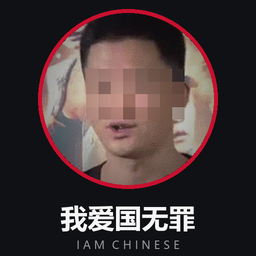

# IamChinese

<p align="center">
  
</p>

> 产品名写 **IamChinese**；包名、命令、目录一律小写 `iamchinese`——npm 只收小写包名。

把开发/测试环境配成一套**内部自洽**的中国用户人设：姓名、身份证（含校验位）、手机号（号段绑定运营商与 ASN）、真实区划码对应的地址、locale、时区、书写约定，加上落地清单、自检和分享包。

一份包，两个身份：

| 装在 | 得到什么 | 清单 |
| --- | --- | --- |
| **DeepSeek Harness** | 5 个模型工具（`cn_persona` / `cn_persona_plan` / `cn_persona_apply` / `cn_persona_check` / `cn_persona_share`）+ 一份 `iamchinese` 技能 | `cordis.patch.yml` |
| **Claude Code** | 一份 `iamchinese` 技能，驱动同一个 CLI | `.claude-plugin/plugin.json` + `skills/iamchinese/SKILL.md` |

两边共用 `bin/iamchinese.mjs` 和 `lib/core/`，逻辑只有一份。

## 为什么值得装

单看每个字段都像真的，凑一起矛盾就是假的。`zh-CN` 配 `Asia/Shanghai` 却挂着 UTC 时间戳、身份证前六位在广州而地址写哈尔滨、号码 189 段却把运营商写成联通——这些是「一眼假」，比名字不像更致命。

所以这个包的重点不是生成得多像，而是六项交叉检查全绿：

1. locale ↔ 时区
2. 身份证区划码 ↔ 地址省市区
3. 身份证第 17 位奇偶 ↔ 性别
4. 号段 ↔ 运营商
5. 号段 ↔ ASN（电信 AS4134 / 联通 AS4837 / 移动 AS9808）
6. 手机号 11 位纯数字

任何一项红，先改数据，别改检查。

## 装上之后：什么都不改，只是被当成中国人

这一条是后加的，也是很多人真正想要的：**不动机器任何设置**，只让 DSH / Claude 在会话里
把用户当成中国大陆用户——说简体中文，按国内的日期、货币、地址、单位习惯来。

| 宿主 | 机制 | 具体做了什么 |
| --- | --- | --- |
| DSH | `ctx.systemPrompt.section({ name: 'iamchinese:china-context', order: 40, text })` | 往系统提示里加一段约 10 行的身份与语言偏好。`order 40` 落在 `deployment:persona-prefix`(0) 之后、plan/team 策略(500/600) 之前：它属于「你是谁」这一档，压不过安全与工具策略 |
| Claude Code | `hooks/hooks.json` 的 `SessionStart` → `hooks/china-context.mjs` | 会话开始时把同一段文字打到 stdout，Claude Code 会把它作为上下文附加给模型 |

这一段里**没有**身份证、手机号、地址样例——常驻提示塞一个假身份证只会让模型把它当事实复述给用户。
样例是工具按需生成的，用完就完。

它明确不碰的东西：

- 不改系统 locale、时区、注册表、浏览器语言列表（`env.ps1` 里那些命令依然要你自己点头才执行）；
- 不改任何工具的参数或行为，五个 `cn_persona*` 工具和一份技能跟以前一模一样；
- 不联网、不写文件、不读用户目录；Claude 侧 hook 即使自己出错也 `exit 0`，不让会话起不来；
- 不假装出口 IP。提示里只写语言与习惯，不写「你从中国上网」——那是线路的事。

想验证它到底加了什么：

```bash
node hooks/china-context.mjs        # Claude 侧：这一段就是模型看到的
```

想临时关掉 DSH 侧：`CN_PERSONA_NO_PROMPT=1` 再重启；彻底不要就 `dsh plugin --profile web remove iamchinese`，
提示跟着一起消失——注册的是一个 cordis effect，撤插件等于撤这一节。

Claude 侧同理，`claude plugin remove iamchinese` 之后 hook 不再运行。

## 安装：DeepSeek Harness

```powershell
# 从源码目录装（开发时）
dsh plugin --profile web add D:\path\to\iamchinese

# 从打包好的 tgz 装（发给朋友就用这个）
npm run dist                     # 产出 dist/iamchinese-0.2.0.tgz
dsh plugin --profile web add .\dist\iamchinese-0.2.0.tgz
```

`dsh plugin` 只是把参数转给 profile 里的 pnpm；装完它自己会把包追加进 `dsh.profile.bundles`，不用手改。验证：

```powershell
dsh --profile web --dump-config | Select-String 'iamchinese'
```

看到 `- id: iamchinese` 就是挂上了。没有 `tools` 服务的 profile 只挂技能、不挂工具，插件本身不会因此加载失败。

**装完要重启 DSH 才生效**：`bundles` 在启动时装配，`patchReload: live` 只热更 `cordis.patch.yml`，不会重新加载刚装进来的包。重启后对话里应该多出五个 `cn_persona*` 工具和一条 `iamchinese` 技能；如果 GUI 起不来，先 `dsh plugin --profile web remove iamchinese` 退回上一版。

## 安装：Claude Code

把整个目录（或 zip 解出来的目录）放进 Claude 的插件目录，或按团队方式引用：

```bash
claude plugin add /path/to/iamchinese      # 本地路径
claude plugin add ./dist/iamchinese-claude.zip # 或发来的 zip
```

Claude 侧拿到的东西和 DSH 侧是同一份逻辑，两块外壳不同：

| 文件 | 作用 |
| --- | --- |
| `.claude-plugin/plugin.json` | 插件清单，Claude 认这个 |
| `skills/iamchinese/SKILL.md` | 技能手册：什么时候该用、六项自洽、边界、常见坑 |
| `commands/persona.md` | `/iamchinese:persona [seed]` 生成并讲解一份人设 |
| `commands/apply.md` | `/iamchinese:apply [目录]` 落成三件套并复验 |
| `commands/share.md` | `/iamchinese:share [名字]` 导出分享包，或起分发页让人扫码 |
| `bin/` `lib/` `scripts/` | CLI、人设逻辑、分发脚本（`${CLAUDE_PLUGIN_ROOT}` 定位，不依赖 cwd） |

技能与命令里所有路径都写成 `${CLAUDE_PLUGIN_ROOT}/...`，所以装在哪都能跑。`scripts/` 是跟着走的：
`share-server.mjs` / `share-qr.mjs` / `verify-qr.py` 在 Claude 侧同样可用，只是 Claude 侧一般没有
`dist/`，起分发页时用 `--dir` 指向放包的那个目录即可。

**这份 zip 自己就能用**，不依赖仓库其它部分——`npm run smoke` 会把它解开、在临时目录里跑一遍
`persona` / `apply` / `share` 并起一次分发页，任何一步不对就红。

## 直接用 CLI（两边都不装也能跑）

```bash
node bin/iamchinese.mjs persona              # 看一份人设，--json 出结构化字段
node bin/iamchinese.mjs apply                # 写 .iamchinese/{cn-profile.json,env.sh,env.ps1}
node bin/iamchinese.mjs verify               # 六项自洽 + 当前环境差哪几项，红了退出码 1
node bin/iamchinese.mjs plan                 # 真改机器前的落地清单
node bin/iamchinese.mjs share --from 我的名字  # 导出能直接发给别人的包
node bin/iamchinese.mjs undo                 # 只删这三件套
```

`--seed N` 复现同一份人设（默认 `20261019`）。跨语言没有稳定契约：仓库里那个 Python 版和这个 JS 版同一个种子结果不同，要跨版本对齐就传完整档案，别传种子。

## 发给朋友

`share` 会写一个自包含目录：

```
iamchinese-share/
├── cn-profile.json     完整人设（含六项自洽所需的全部字段）
├── env.sh              等价 shell 环境
├── env.ps1             Windows 等价命令
└── README.md           这是样例、别拿去注册或实名
```

末尾还会给一句能直接粘贴到微信里的话。包里没有任何凭据、token、真实手机号——只有按种子拼出来的样例。

## 现场分发：一个二维码

想「掏手机扫一下就下到包」，用这两个脚本（都不联网、不起外网服务）：

```bash
npm run dist     # 顺便生成 dist/qr.png
npm run share    # 起本机分发页，默认 http://<你的局域网 IP>:8848/
```

`/` 是落地页（三步安装说明 + 两个包的直接下载 + 三条边界），`/qr.png` 是二维码，
`?url=` 可以临时换目标。二维码由 `scripts/lib/qr.js` 现编——这个包里没有 `qrcode` 依赖：

```bash
node scripts/share-qr.mjs --url https://你的域名/ --out qr.png   # 换成公网地址
python scripts/verify-qr.py --png qr.png --expect https://你的域名/   # 用 OpenCV 验一遍真能扫
```

编码器只做 1–6 版、字节模式、纠错 M/Q（Q 级 6 版放 74 字节，够放 URL），超长直接报错不偷偷降级。
`test/qr.test.mjs` 验结构（定位图案、格式信息、掩码罚分），能不能被扫出来由 `scripts/verify-qr.py`
用 OpenCV 的真解码器验，12 条边界用例（6 版本 × M/Q，正好塞满容量）全过才算数。

## 它不做什么

- **不改系统设置**。`env.ps1` 里那些 `Set-Culture` / `Set-WinUILanguageOverride` / `tzutil` 是真改机器，要你自己点头执行；`undo` 不会把系统改回去。
- **不提供出口 IP**。人设里的 `egress_ip` 落在 RFC 5737 的 `203.0.113.0/24` 文档段，故意选的，它永远不会撞到真人。要让 CDN 看到中国出口只能是真实的中国线路，这个包不代填、也不假装能绕过去。
- **不碰网络**。零依赖，不发请求，不读凭据。
- **不用于实名**。拿去注册账号、过 KYC、开卡，性质就从「配环境」变成「伪造证件」，不在这个包的范围内。

## 数据从哪来

区划码、号段、ASN 都是公开编码规则里的事实，用来让字段之间能对得上；具体挑哪一组由种子决定，不是查某个真人的资料。年龄、性别、职业、单位、门牌、邮箱后缀全部按规则拼。同一份人设会带上 `203.0.113.x` 这种一眼能看出是文档段的地址，方便你事后分辨哪些是样例。

## 开发

```bash
node --test         # 70 个用例，零依赖，断网可跑
npm run cli -- --help
npm run dist        # 打 tgz + zip + qr.png 并打印内容清单
npm run smoke       # 把 Claude zip 解开，当「朋友的机器」从零跑一遍
```

`test/cli.test.mjs` 盯的是 `bin/iamchinese.mjs` 的 `main()`——DSH 工具和 Claude 命令都从它走，
它坏了两个外壳一起坏：参数解析、退出码（0 通 / 1 自检红 / 2 未知子命令）、`apply` 只落三件套、
手改档案后 `verify` 必须红、`undo` 不误删同目录其它文件。

其中两组是跟真宿主对表，不是跟自己写的假 ctx 对表：

- `test/host-contract.test.mjs`——拿宿主的真校验器跑（`validateArgs` /
  `assertSupportedJsonSchema` / `validateJsonSchemaValue`）。参数写错形状时自己的测试会全绿
  而宿主的 `validateArgs` 直接抛 `UNSUPPORTED_SCHEMA`，这类错只有跑真校验器才暴露。
- `test/cordis-mount.test.mjs`——import 宿主那份 `@deepseek-ai/cordis`，用 `provide`/`set`
  搭最小服务环境，真走一遍 `ctx.plugin()` → `apply()` → `ctx.inject()` → `ctx.effect()` → 注销，
  断言五个工具挂上、注销后清空、`skills` 服务后到也能补注册。

这两组在没装 DSH 的机器上整组跳过，不影响使用。

目录：`lib/core/`（纯逻辑，无 IO）、`lib/`（宿主装配与工具）、`bin/`（CLI）、`skills/`+`commands/`+`.claude-plugin/`（Claude 侧）、`scripts/`（打包、分发页、二维码、冒烟）、`test/`（node:test）。

## License

MIT
